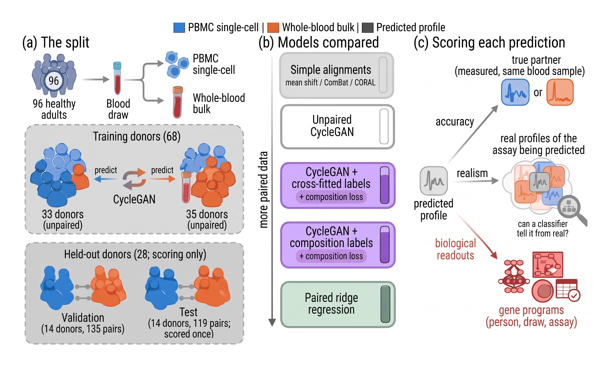

# What can a generative model recover about a person's immune cells without paired samples?

*Predicting between PBMC single-cell (pseudobulk) and whole-blood transcriptomes.*

**Arushi Sahai**<br>
arushis@cs.unc.edu<br>
Final project (solo) for COMP 690-204, Deep Generative Models, UNC Chapel Hill, Fall 2026

**[Read the results page](https://arushi-sahai.github.io/unpaired-singlecell-bulk-cyclegan/)** for the question, the findings, and what they mean. This README covers how the work was done: the workflow, the code, and how to rerun the analysis.

## Why it matters

Whole-blood bulk RNA-seq is cheap and is the only transcriptome in many large clinical and biobank cohorts, while single-cell RNA-seq of PBMCs resolves immune cell types but is costly. A model that predicts one from the other would let bulk-only cohorts study how immune cell types change with disease, age, and treatment. Most cohorts have only one assay, so such a model would have to be learned without paired samples, which is the setting this project tests.

## The cohort

The Allen Institute for Immunology's Sound Life cohort followed 96 healthy adults over about two years, and every blood draw was profiled by both PBMC single-cell RNA-seq and whole-blood bulk RNA-seq, giving 836 matched pairs. Some draws were taken just before and seven days after a flu vaccination, so the cohort also records a known immune response, the rise in antibody-secreting plasmablasts about a week after the shot.

## Results

Without paired samples, the CycleGAN learned little beyond a simple per-gene correction between the assays. Its predictions mostly reflected each person's usual immune profile, and only some of what changed from one blood draw to the next. The CycleGAN was also no more realistic than blends of simple alignments at equal accuracy. Training on paired samples did better: with 8 paired donors, plain ridge regression (without the spread step) roughly matched the average profile, and with all 68 it scored above the average profile (centered R² 0.16 when predicting bulk and 0.24 when predicting single-cell profiles, point estimates), which no unpaired method did. Accuracy stayed low for every method. For a bulk-only cohort, adding single-cell data from the same blood draws for some donors helped more than any unpaired model tested.

**Stack:** Python, PyTorch, scanpy and AnnData, scikit-learn, and baselines from ComBat, CORAL, Harmony, and entropic optimal transport.

## Workflow

- **Data (Phase 0).** Raw Sound Life counts become 836 matched pairs of PBMC single-cell pseudobulk and whole-blood bulk profiles from 96 donors, on a 5,000-gene panel chosen on training donors only.
- **The comparison (Phase 1).** Every model is scored for accuracy against its sample's true partner and for realism. Blends of simple alignments, such as mean shift and ComBat, set an accuracy–realism frontier that a model has to beat.
- **The models (Phases 2–3).** CycleGANs are trained on two halves of the training donors that never share a person, one half giving only single-cell profiles and the other only bulk profiles. Optional composition labels come from networks trained on pairs. Settings and checkpoints are locked on validation data.
- **Analysis on validation (Phases 4–6).** Ablations, exploratory changes, and analyses of what the CycleGAN changes.
- **One test run (Phase 7).** The locked models and every baseline are scored on the test split once.
- **Figures and biology (Phases 8–9).** The report's figures and tables, then biological readouts on validation data: gene programs, donor traits, cells only one assay sees, and the vaccine response.



## Repository

| Path | Contents |
|---|---|
| `notebooks/` | One executed notebook per phase, outputs kept. `project_overview.ipynb` is the index. |
| `dgm/` | Shared code, used by more than one notebook (table below) |
| `tests/` | Known-answer tests, one module per component |
| `results/phaseN/` | Result tables (CSV), figures, and captions for each phase |
| `scripts/` | Data rebuilding, the synthetic checks, and the results page's figures and links |
| `report/` | LaTeX tables, generated number macros (`numbers.tex`), the bibliography, and the figure register |
| `notes/` | The plan fixed before training (`phase3_plan.md`), the phase specs, the pilot record, the deviations from the proposal, future work, and the AI-use log |
| `proposal/` | The submitted proposal and `ERRATA.md`, which lists its errors and the design changes made since |
| `index.html`, `assets/` | The results page, served by GitHub Pages from the repository root |

### Notebooks

| Phase | Notebook | What it does |
|---|---|---|
| 0 | `phase0_preprocessing.ipynb` | Cell QC, pseudobulk, normalization, the gene panel, donor splits, and the size of the gap between the assays |
| 1 | `phase1_evaluation.ipynb` | The evaluation measures, the simple alignments and paired baselines, and the frontier |
| 2 | `phase2_composition_nets.ipynb` | Composition networks and their robustness to adversarial inputs |
| 3 | `phase3_translation.ipynb` | The CycleGAN grid, checkpoint and setting selection, and the locked models |
| 4 | `phase4_ablations.ipynb` | What each loss and component does |
| 5 | `phase5_exploratory.ipynb` | Changes to the CycleGAN and cross-fitted composition labels |
| 6 | `phase6_analysis.ipynb` | Why the CycleGAN lands where it does, optimal transport, and how many pairs help |
| 7 | `phase7_test_evaluation.ipynb` | The one test run, with donor-bootstrap intervals |
| 8 | `phase8_figures.ipynb` | Report figures, tables, number macros, and the page's `assets/data.js` |
| 9 | `phase9_biology.ipynb` | Gene programs, donor traits, cells only one assay sees, and the vaccine response (validation only) |

### Names used in the notebooks and result files

The notebooks are the working record and use short names.
- **M1**: the unpaired CycleGAN
- **M2**: CycleGAN + composition labels
- **B-cf**: CycleGAN + cross-fitted labels
- **ridge + spread**: paired ridge regression
- **OT-s**: optimal-transport retrieval
- **no-information reference**: the random real profile
- **H1, H2, and H3**: the three machine-learning questions. H1 asks whether the unpaired CycleGAN is beyond the frontier, H2 whether composition labels help, and H3 what pairs add.
- **probe**: a readout, such as the marker-gene readout
- **halving 0 and 1**: the two divisions of the training donors into unpaired halves
- **suspect** (in `h2_suspect_test.csv`): a composition gain under the network the CycleGAN trained against that the independent marker-gene readout does not confirm

### The `dgm` package

The package is named for the course, Deep Generative Models (COMP 690-204). It holds the code that more than one notebook uses.

| Module | Contents |
|---|---|
| `data.py` | The pairs file (`Pairs`), its checks, and `train_halves`, which divides the training donors into the two unpaired halves |
| `metrics.py` | Every evaluation measure: centered R², realism (a classifier two-sample test), partner ranks, composition readouts, and collapse guards |
| `baselines.py` | Mean shift, ComBat, CORAL, Harmony, and the paired baselines |
| `frontier.py` | The frontier of the simple alignments and a model's margin beyond it |
| `models.py` | Network building blocks shared by the composition networks and the CycleGAN |
| `composition.py`, `labels.py` | Composition networks (Phase 2) and cross-fitted composition labels (Phase 5) |
| `translation.py` | The CycleGAN, its training loop, and checkpoint selection |
| `grid.py` | Parallel, cached execution of training runs |
| `ablation.py`, `analysis.py`, `ot.py` | Phase 4 ablations, Phase 6 analyses, and optimal-transport retrieval |
| `testeval.py` | The test bootstrap and the verdict rules |
| `deconv.py` | Reference deconvolution, a composition readout for bulk that uses no pairs |
| `biology.py` | Phase 9 gene-program scores and readouts |
| `report.py`, `plotting.py` | Number formatting for the report and the shared figure style |
| `notebook.py`, `paths.py` | The setup every notebook runs first (commit, source hash, and seeds) and file locations |

## Setup

```bash
conda env create -f environment.yml
```

```bash
conda activate dgm-soundlife
```

Register the environment as a Jupyter kernel with `python -m ipykernel install --user --name dgm-soundlife`, the kernel name the notebooks record. Training runs on the CPU. A GPU is not needed.

## Data

The inputs are from the AIFI Sound Life study (Gong et al., 2025), data doi:10.57785/bn17-3h16, licensed CC BY 4.0:
- **Single-cell:** the 8 portal files (age group × sex × CMV status), reduced to "slim" files of a uniform random 3,000 cells per sample.
- **Bulk:** the whole-blood counts file `sound-life_whole-blood_no-stim.h5ad`.

The data are not in this repository. To rebuild the slims, download the 8 single-cell portal files and run

```bash
python scripts/make_slims.py <directory with the portal files>
```

The script selects the listed cell barcodes (`scripts/slim_barcodes/`) and verifies each slim's content checksum. Put the slims and the bulk file in `data/raw/soundlife/`. Phase 0 checks every raw file against pinned SHA-256 checksums before using the files.

## Reproducing

Run the notebooks in order. Each one reads only what earlier phases wrote to `data/processed/` and `results/`.
- **Caches.** Processed data and trained models are cached under keys that include their parameters and a hash of the code that built them, so editing that code rebuilds the affected caches. The keys also include the library versions, so a different PyTorch build, a CPU-only one for example, retrains instead of reusing the caches. Set `FORCE = True` in a notebook's setup cell to rebuild everything.
- **Determinism.** `dgm.notebook.setup` seeds every random generator, and training fixes the thread count and turns on PyTorch's deterministic algorithms, so reruns reproduce the saved results. The first code cell of each notebook prints the commit and the notebook's source hash. Those commits belong to the development history, which is not public. For the test evaluation, the audited code hash identifies the code that was run (see "How decisions were kept honest").
- **Runtime.** Phase 0 takes about 10 minutes after hashing about 28 GB of raw files. The model grids of Phases 3–5 take several hours to a night each on a laptop.
- **Phase 7 needs a switch.** Set `PHASE7_DRY=1` for a dry run on the validation split, or `PHASE7_TEST=1` to score the test split, which works only with the audited code (see "How decisions were kept honest").

### Tests

Each module has known-answer tests on small synthetic data with known structure (`tests/synthetic.py`). For example, a perfect prediction must find its own partner every time, a CycleGAN run must repeat exactly under the same seed, and the CycleGAN must recover a known per-gene transform about as well as ComBat.

```bash
python -m tests.test_metrics
```

Run the others the same way (`python -m tests.test_<name>`), or all of them with

```bash
for t in tests/test_*.py; do python -m tests.$(basename $t .py) || break; done
```

`python -m scripts.phase3_synthetic_checks` reruns the larger synthetic recovery checks reported in Phase 3.

## How decisions were kept honest

- **Fixed before training.** The machine-learning questions and the rules for judging their answers were fixed before any CycleGAN was trained (`notes/phase3_plan.md`), with one dated change after a pilot on validation data (`notes/phase3_pilot.md`).
- **Specs before code.** Each phase from 2 on has a written spec in `notes/`, including the decision rules for the Phase 9 readouts, which were planned after the test evaluation and use validation data only.
- **One look at the test split.** Phase 7 hashes the audited analysis code (the `dgm/` modules, the Phase 7 tests, and the notebook's code cells) and scores the test split only when the current code matches that hash, so nothing could be tuned after seeing test results. The test split was scored once. A second, display-only run, with its hash recorded by hand, reproduced every result file byte for byte. Both runs are logged in `results/phase7/test_touch.json`. Since then, `dgm/report.py` (report figures and tables) and `dgm/biology.py` (the Phase 9 readouts) were added, and one display name changed in `dgm/plotting.py`. None of these changes affects the test computation, but the hash covers every module, so the hash check now blocks any rerun on test.
- **Logged deviations.** Every departure from the proposal or a spec is listed with its reason in `notes/deviations.md`.
- **Numbers from files.** Every number in the report is generated from result files. The results page fills most of its numbers from result files too, and the rest were checked against those files. `scripts/fix_page_rounding.py` rounds the page's numbers once, from full precision.

## Known issues

`notes/known_issues.md` lists a few stale comments in code that is frozen at the audited hash, how the test frontier curve on the results page was drawn, and wording kept as written in the historical analysis plan.

## How the results page is built

The page is static HTML. Its numbers are filled at load time from `assets/data.js` (written by Phase 8) and `assets/data_bio.js` (written by `scripts/make_bio_page_data.py` from `results/phase9/`).

| Script | What it does |
|---|---|
| `scripts/make_public_figures.py` | Reruns the Phase 8 and 9 figure cells in a temporary copy with plain wording and the page's colors (`scripts/public_figure_style.py`), and checks that every result CSV is unchanged |
| `scripts/make_public_dev_figures.py`, `make_public_gap_figure.py`, `make_frontier_figure.py`, `make_overview_figure.py` | The page's other figures, drawn from saved result files |
| `scripts/link_terms.py` | Links defined terms, citations, and figure references, and fills the hover texts. |
| `scripts/make_og_image.py` | The link-preview image |
| `scripts/fix_page_rounding.py` | Rounds the page's numbers once from full precision and rewords the footnote of the comparisons table. Run it after Phase 8 writes `assets/data.js`. |

## Use of AI tools

Arushi Sahai designed and directed the study, interpreted the results, and directed and revised the text. Claude (Anthropic), through Claude Code, wrote the new code under that direction and ran the training and evaluation runs.
The full statement, with the author's main contributions, is in [`notes/ai_use.md`](notes/ai_use.md), and the session-by-session log is in [`notes/llm_usage.md`](notes/llm_usage.md).

## License

The code is released under the MIT License (`LICENSE`). The Sound Life data are not included and keep their own license (CC BY 4.0).

## References

- Gong, Q., Sharma, M., Glass, M. C. et al. Multi-omic profiling reveals age-related immune dynamics in healthy adults. *Nature* 648, 696–706 (2025). doi:10.1038/s41586-025-09686-5.
- Zhu, J.-Y., Park, T., Isola, P. & Efros, A. A. Unpaired image-to-image translation using cycle-consistent adversarial networks. *ICCV* (2017).

The results page lists every work it cites. The full bibliography is `report/references.bib`, and each notebook lists the works it cites at its end.
